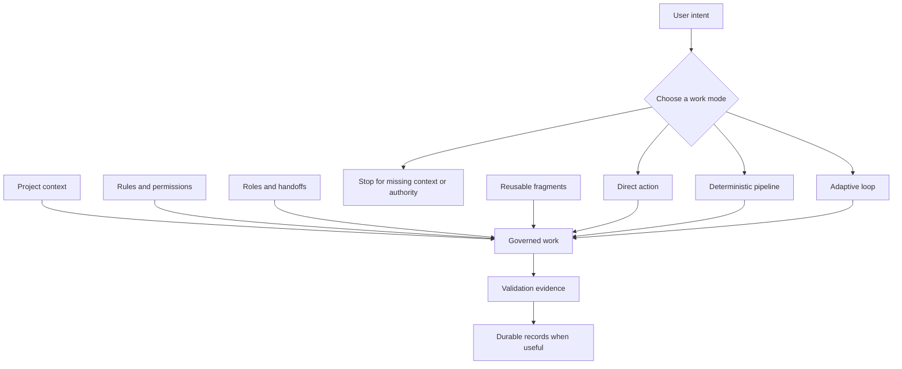
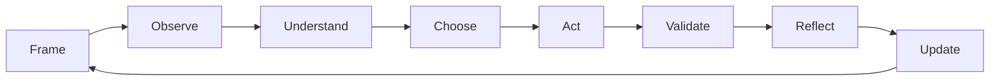
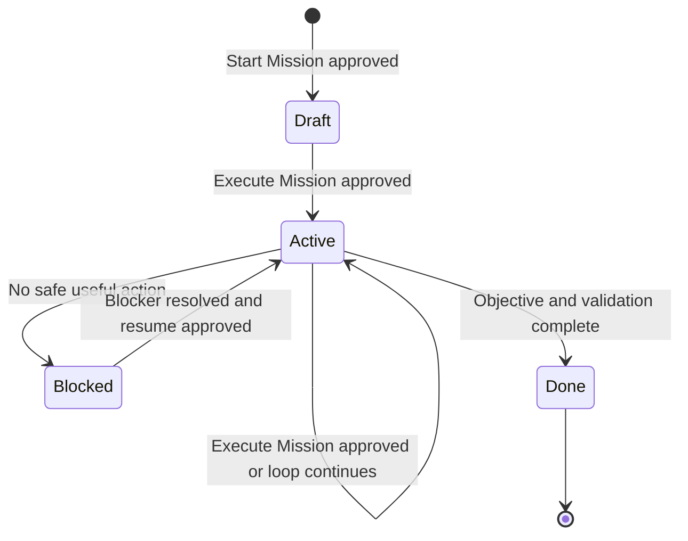
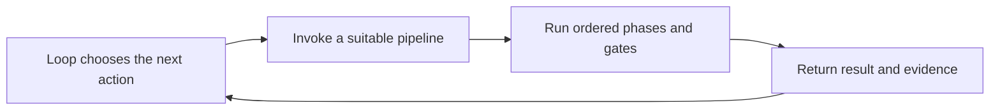

# Pipes

Pipes is a Markdown-first framework for governed AI work.

Its job is to help an agent move quickly without losing scope, authority, evidence, or durable project memory. Markdown files are the framework. Scripts only compile those files into generated discovery surfaces.

## The Model

Pipes turns user intent into the lightest safe work mode, applies repository context and governance, and closes work with evidence.



Pipes governs consequential choices. It does not turn every tool call into a transaction, every conversation turn into stored state, or every role into a background agent.

## Choose A Work Mode

| Mode | Use it when | Durable mission required? |
| --- | --- | --- |
| Direct action | The request is clear, bounded, low risk, and needs no reusable workflow | Usually no |
| Pipeline | The phase order, inputs, outputs, and gates are already known | Only when durable adaptive state helps |
| Loop | The next action depends on evidence, iteration, recovery, or validation | Use one when continuity or governance benefits |
| Stop | Required context, authority, or a safe useful action is absent | No |

Several steps do not automatically require a mission. Create one when objective, scope, authority, evidence, gates, and the next action need durable continuity.

## Staged Starter And Installed Project

This repository maintains the distributable starter under `.pipes.example/`. The folder name marks the staged source only; when installed into a product, its contents live at canonical `.pipes/` paths.

Framework maintenance changes `.pipes.example/` first, validates the staged contract, reconciles the repository's installed `.pipes/` counterpart, and refreshes affected generated discovery surfaces. Consumer-facing instructions and generated files use `.pipes/`, never `.pipes.example/`.

## Framework Provenance And Versioning

The staged framework is a versioned release source. `utils/rules/rule-framework-provenance.md` defines its provenance contract. The current baseline is framework version `2.2.1`. It uses manifest schema version 2. New manifests use project-layout version 3; layout 2 stays readable. The compressed baseline archive and fork control use schema version 1.

The provenance contract tracks framework instructions, team roles, fragments, pipelines, rules, scripts, and three explicit shared files. Project records, local configs, runtime state, issue records beyond their shared README and placeholder, incidental files, and the provenance metadata itself remain excluded. Only immediate project-area directory names participate in baseline identity; project file details never do.

Every changed tracked baseline requires a different valid framework semantic version before release metadata can be replaced. Clean installations use an `origin` relation, existing manifest-less workspaces use `adopted`, and missing trustworthy relation evidence uses `unresolved`. An installed manifest and baseline archive are immutable provenance until an explicitly authorized upgrade or initialization owns their replacement.

The dependency-free `utils/scripts/generate-framework-provenance.cjs` tool takes one explicit framework root and one mode. Checking is read-only:

```sh
node .pipes/utils/scripts/generate-framework-provenance.cjs --root .pipes --check
```

Refreshing an installed fork writes only changed fork-control bytes after validating the manifest and archive:

```sh
node .pipes/utils/scripts/generate-framework-provenance.cjs --root .pipes --refresh-fork
```

First baseline creation and later baseline replacement are protected release operations. They require `--allow-baseline-initialization` or `--allow-baseline-replacement` and an explicit framework semantic version. Obtain the governing approval before using either mode against a non-temporary root. This starter uses schema-v2 `2.2.1` origin metadata. Run the read-only check above to verify that the tracked content matches this release baseline.

## Canonical Surfaces

| Surface | Purpose |
| --- | --- |
| `ai-instructions/` | Project identity, core orchestration behavior, and architecture context |
| `project/` | Notes, intents, specs, missions, plans, decisions, outcomes, and artifacts |
| `team/` | Reusable responsibilities, consultation, and handoff boundaries |
| `utils/fragments/` | Atomic instruction, question, output, and validation units |
| `utils/pipelines/` | Deterministic phase workflows |
| `utils/loops/` | Adaptive mission classes |
| `utils/rules/` | Binding and advisory governance |
| `utils/scripts/` | Static generators, record inspection, and development tests |

Markdown under these surfaces is authoritative. Catalogs, wrappers, skills, and source maps are generated discovery aids.

## Five Starter Loops

| Loop | Use it for | Primary role |
| --- | --- | --- |
| `loop-concept-development` | Clarifying ideas, alternatives, and durable direction | `visionaire` |
| `loop-feature-delivery` | Planning, implementing, and validating a bounded feature | `full-stack-tech-lead` |
| `loop-investigation-and-recovery` | Diagnosing failures, testing hypotheses, and proving recovery | `full-stack-tech-lead` |
| `loop-framework-maintenance` | Changing Pipes contracts and reconciling generated surfaces | `roadmapper` |
| `loop-artifact-production` | Producing and inspecting documents, decks, reports, images, or exports | `roadmapper` |

Every loop follows the same adaptive rhythm:



A loop keeps working until the objective is validated, a genuine user decision is required, a blocker prevents useful progress, or the next action is protected. Routine observations, choices, validation, and corrections stay inside the loop.

## Eighteen Starter Pipelines

| Pipeline | Purpose |
| --- | --- |
| `pipeline-create-loop` | Create a distinct adaptive loop and refresh its discovery surfaces |
| `pipeline-create-pipeline` | Create a deterministic fragment-driven workflow |
| `pipeline-create-team-member` | Create a reusable role contract |
| `pipeline-define-codebase-stack` | Establish project identity, stack, boundaries, and conventions |
| `pipeline-define-system-architecture` | Create or refresh the architecture instruction |
| `pipeline-plan-new-feature` | Produce a validated executable feature plan |
| `pipeline-start-mission` | Create an approved draft mission and stop before execution |
| `pipeline-execute-mission` | Validate readiness, obtain execution approval, and start the selected loop |
| `pipeline-execute-plan` | Execute an approved plan with lifecycle synchronization and outcome-backed closure |
| `pipeline-record-decision` | Capture an approved durable choice and its consequences |
| `pipeline-capture-intent` | Turn an idea, ticket, or incident into an intent the product owner accepts (G1) |
| `pipeline-design-spec` | Turn an accepted intent into a spec with requirement IDs (G2) |
| `pipeline-review-change` | Review a change with a verifier and a non-author reviewer; never approve (G4 stays with code owners) |
| `pipeline-release-change` | Release or promote through the delivery profile's environments behind G5 |
| `pipeline-add-eval` | Turn an incident, repeated mistake, or contract into a behavioral eval case |
| `pipeline-onboard-service-repo` | Align one service repository's agent docs with the project's policies |
| `pipeline-define-policies` | Derive project policy rules from what the repositories already state |
| `pipeline-bootstrap-workspace` | Set up a new workspace in order: stack and delivery, policies, architecture, generation, evals |

Each pipeline preserves its declared phase order. A phase states its Objective, Acting Role, optional Support Team, Entry Conditions, Inputs, Fragments, Instructions, Outputs, Handoff To, Approval Gate, and Exit Conditions.

The acting role owns the phase. Support roles advise without becoming extra actors. Handoff To names the next owner and stays empty at a terminal phase.

## Missions

A mission is one readable Markdown page for a concrete loop run. It keeps small frontmatter and readable sections for Objective, Scope, Delivery, Operating Envelope, Roles, Current State, Gates, Validation, Stop, Next Actions, and Journal. Delivery decomposes new mission scope into high-level themes with dependencies, affected contract families, and planning classifications without becoming an implementation plan.

Every new mission requires an explicit human-intervention selection:

| Selection | Autonomy profile | Expected behavior |
| --- | --- | --- |
| `less` | `delegated_until_escalation` | Continue independently inside delegated scope and escalate at declared boundaries |
| `more` | `user_mediated` | Return to the user at meaningful choices and protected actions |
| `context-dependent` | `mixed` | Delegate routine bounded work while preserving explicit user-owned gates |

The selection may narrow authority but never widens permissions, rules, pipeline gates, or protected-action boundaries.

Mission creation and execution are separate approval boundaries:



Mission `status` records lifecycle state, while a Journal gate receipt records execution approval. `pipeline-start-mission` frames the work, selects one loop, treats its pipelines as optional capabilities, decomposes delivery themes, records an informed `spec-driven` or `adaptive` route, presents an exact draft preview, writes the approved `draft`, and stops without invoking planning or execution. `pipeline-execute-mission` accepts both `draft` and `active` as readiness candidates, re-reads the record and current evidence, presents a version-bound readiness package including delivery continuity when present, requires explicit execution approval, normalizes the mission state, and hands work to its loop. An `active` status does not by itself prove execution approval; an active mission with a pending execution gate or a Journal statement that execution has not started proceeds to readiness instead of correction.

Mission records avoid embedded runtime snapshots, duplicate frontmatter projections, private reasoning, and exhaustive transcripts. Current State and Next Actions describe what matters now; Journal keeps short milestones and gate receipts. Content before `## Journal` stays at or below 300 physical lines.

## Plans And Outcomes

Execute Plan distinguishes a recorded plan from exact approved inline content. A recorded plan moves from `draft` to `active` after execution approval and readiness, records a resumable blocker as `blocked`, resumes `active` only with resolved evidence and current authority, and reaches `done` only after exactly one validated reciprocal outcome records its terminal result. Inline content executes without an invented plan record, status, relationship, or mandatory plan outcome. A plan outcome closes only its source plan; a recorded mission still requires its own distinct terminal outcome.

## Pipelines Inside Loops

Loops may invoke pipelines for deterministic subroutines. Every pipeline has a `## Loop Use` contract describing when it fits, required context, returned output, remaining gates, and recovery after a pause.



The pipeline owns its phase order while it runs. The loop owns the decision to invoke it and what to do with the result. The mission records the active pipeline phase only when resumption would otherwise be ambiguous.

An immediate approved gate resumes the exact recorded action while its approval remains valid. A cold or stale resume re-reads the files, record, evidence, and approval before continuing from the first incomplete phase.

## Roles, Fragments, And Rules

The starter kit provides nine roles: `visionaire`, `roadmapper`, `full-stack-tech-lead`, `fe-architect`, `fe-coder`, `be-architect`, `be-coder`, `e2e-tester`, and `reviewer`. `reviewer` and `e2e-tester` can also run as read-only isolated agents. Roles provide ownership and perspective; they do not impersonate the user, imply background agents, or widen authority.

The current starter contains 115 fragments grouped as context, instructions, questions, outputs, and validations. Pipelines and loops reference fragments by ID; resolve each exact filename recursively under `.pipes/utils/fragments/` and require exactly one match. Use `utils/fragments/CATALOG.md` for discovery, but treat the fragment Markdown as authoritative.

The current starter contains 27 binding or advisory rules. Project policy rules (`scope: project`) are project content, written by `pipeline-define-policies`, and never part of the starter. Binding rules govern scope, authority, validation, records, recovery, generated surfaces, and version-control effects. When constraints conflict, the strictest applicable authority wins.

Generated durable artifacts follow `rule-artifact-record-contract` for names, complete metadata, explicit sources, reciprocal creation checks, and regeneration. Standalone HTML artifacts follow `rule-generated-html-design`. The rule supplies the Pipes Local token baseline, accessible controls, responsive layouts, and automatic light and dark themes. Renderable Markdown continues to follow `rule-pure-markdown-writing`.

## Durable Project Records

| Record | Owns |
| --- | --- |
| Notes | Source material, research, and exploratory context |
| Intents (`01-intents`) | One problem and its proposed outcome, accepted by the product owner |
| Specs | Accepted requirements and design that plans cite by requirement ID |
| Missions | Adaptive work state, gates, validation, and next action |
| Plans | Bounded executable specifications |
| Decisions | Lasting commitments and rejected alternatives |
| Outcomes | Factual closure and residual risk |
| Artifacts | Supporting evidence, exports, and generated assets |

Create a record only when its content will help future work. Relationships use unique readable project-relative paths. Detailed evidence belongs in its natural file or under `project/07-artifacts/`, not inside an oversized mission journal.

Run `validate-project-records.cjs` in default report mode during active work. It checks area schemas, statuses, relationships, selected loops, required mission sections, timestamps, and terminal consistency without interrupting ordinary work. Use strict mode only when strict or CI verification is explicitly required.

## Gates And Protected Actions

Pipes applies external permissions, binding rules, project instructions, loop protections, pipeline gates, and the mission's intervention profile together. A lower-level preference may narrow authority but cannot widen it.

A pending gate records its subject, gate type, deciding authority, status, invalidation conditions, exact resume trigger, and next action. An approved gate leaves a compact receipt so immediate continuation is safe and cold resumption can reassess the decision.

The user retains control of human-mandatory gates, scope or product-direction changes, destructive actions, staging, commits, pushes, publication, deployment, external sends, and authority that was not delegated.

## Scripts And Generated Entrypoints

The supported static generators are:

- `assemble-instructions.cjs` for managed sections in `AGENTS.md`, `CLAUDE.md`, and `.github/copilot-instructions.md`;
- `assemble-pipeline-skills.cjs` for one managed skill per pipeline under `.agents/skills/` and `.claude/skills/`;
- `assemble-loop-skills.cjs` for one managed skill per loop under `.agents/skills/` and `.claude/skills/`;
- `assemble-agents.cjs` for read-only isolated-agent wrappers in `.claude/agents/`, generated from team roles that declare `subagent: true`;
- `assemble-rule-skills.cjs` for one policy skill per rule that declares `skill: true`, under `.agents/skills/` and `.claude/skills/`;
- `assemble-hooks.cjs` for the managed Claude Code hooks and settings in `.claude/settings.json`, generated from rules that list `hook` or `managed-setting` in `enforced_by`;
- `generate-catalog.cjs` for the fragment, pipeline, loop, and rule inventory;
- `generate-source-map.cjs` for staged-to-installed source coverage.

Scripts may also inspect project records and run development tests. `delivery-profile.cjs` reads and validates the Markdown delivery profile in `ai-instructions/delivery.md` that hooks and workflows use for project facts. `starter-layer.cjs` defines the framework and project layers, and `layer-separation.test.cjs` fails when a framework file contains a project fact derived from `delivery.md` or `project.md`. `verify-starter.cjs` builds a temporary `.pipes.example` with the project layer reset to placeholders and runs every generator and test in starter mode; nothing outside the temporary directory changes. `report-metrics.cjs` reports the SDLC indicators that Pipes records already hold, read-only. `run-evals.cjs` runs behavioral eval cases from `utils/scripts/fixtures/evals/` through an agent adapter in a disposable workspace copy; it is required before gate G6 approvals. The `hook-*.cjs` scripts run as read-only Claude Code PreToolUse hooks that return allow, ask, or deny under `rule-deterministic-enforcement`. They do not choose mission actions, own workflow state, schedule work, enforce a runtime kernel, or replace agent judgment.

The framework-provenance rule also permits deterministic static generation and freshness validation of the versioned manifest, compressed baseline archive, and fork control. That tooling remains subordinate to canonical Markdown and may not infer workspace history or overwrite installed provenance without explicit authority.

After changing canonical Markdown, refresh only the affected generated surfaces. A clean temporary installation must regenerate coherent wrappers, one managed skill per discovered pipeline and loop for each supported skill target, catalog and source-map coverage, and canonical `.pipes/` references without staged `.pipes.example/` path leaks.

## Start Here

1. Read `ai-instructions/project.md` and `ai-instructions/architecture.md` for repository-specific context.
2. Choose direct action, a pipeline, or a loop using the lightest safe-mode rule.
3. Read the selected pipeline or loop and only the fragments and rules needed for the current action.
4. Keep scope, authority, protected effects, evidence, and the next action visible.
5. Validate the real changed surface before claiming completion.
6. Record only durable information in the project record type that owns it.

## Working Rules

- Preserve user-owned and unrelated work.
- Ask only when the answer changes the result and cannot be reliably discovered.
- Keep moving while a safe useful action exists.
- Stop at material choices, protected actions, genuine blockers, or missing authority.
- Do not repeat interrupted or externally visible effects until actual state is inspected.
- Treat evidence, not confidence, as the completion standard.

Pipes combines bold execution with visible governance in Markdown that an agent and a human can both inspect.
