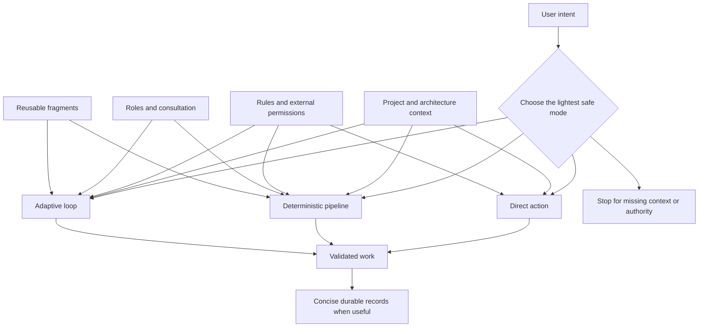
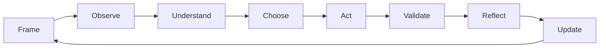
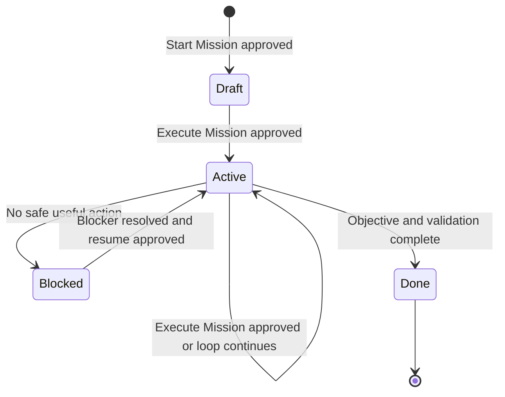

# Core: Pipes Workflow Contract

This file is part of the Pipes core contract and has the same authority as `.pipes/ai-instructions/core.md`. It is assembled as a reference, so agents read it when they run a pipeline, loop, mission, or record workflow. Generated pipeline and loop skills read it first.

## Component Model

| Component | Home | Responsibility |
| --- | --- | --- |
| AI instructions | `ai-instructions/` | Project identity and operating context |
| Project records | `project/` | Durable intent, work, choices, evidence, and closure |
| Team roles | `team/` | Responsibilities, consultation, and handoffs |
| Fragments | `utils/fragments/` | Atomic reusable instruction units |
| Pipelines | `utils/pipelines/` | Deterministic phase workflows |
| Loops | `utils/loops/` | Adaptive mission classes |
| Rules | `utils/rules/` | Binding or advisory governance |
| Scripts | `utils/scripts/` | Static generation and read-only validation only |

## How The Components Work Together

Project context establishes what is true here. Rules and permissions establish what is allowed. Roles establish responsibility. Fragments provide reusable instruction units. Pipelines order known work, loops adapt to evidence, and records preserve only durable state.

## Fragment Resolution

Pipelines and loops reference fragments by ID while files are grouped by type. Before reading a referenced fragment, resolve its exact filename recursively under `.pipes/utils/fragments/` and require exactly one match. Never infer a type directory from the fragment ID or adjacent references; treat zero or multiple matches as an integrity error. Use the canonical path shown in `.pipes/utils/fragments/CATALOG.md` for discovery, while the fragment Markdown remains authoritative.

## Loop Contract

A loop defines a mission class, operating envelope, roles, adaptive phases, Mission Integration, available pipelines, gates, validation, and stop conditions. Its recurring shape is:

The agent may move between phases as evidence requires. It should not force one action per turn or stop after a routine phase boundary. Mission Integration explains how a recorded mission uses the loop and when the loop can be used without a mission.

## Loop Pace

Continue the loop until one of these conditions is real:

- the objective is satisfied and validation is adequate;
- the user must make a material choice;
- the next action is protected and needs approval;
- a blocker prevents meaningful progress.

A question is warranted only when the answer changes the result and cannot be reliably discovered. A status update, completed phase, or mildly uncertain implementation detail is not by itself a stop condition.

## Mission Record

A mission is one readable Markdown file. Its frontmatter stays small; its body holds the state a human or agent needs:

- Objective
- Scope
- Delivery
- Operating Envelope
- Roles
- Current State
- Gates
- Validation
- Stop
- Next Actions
- Journal

The mission is the readable orchestration map for the journey until its conclusion. Every new mission requires one explicit human-intervention selection:

| Human intervention | Autonomy profile | Meaning |
| --- | --- | --- |
| `less` | `delegated_until_escalation` | Continue independently inside delegated scope and escalate at declared boundaries |
| `more` | `user_mediated` | Return to the user at meaningful choices and protected actions |
| `context-dependent` | `mixed` | Delegate routine bounded work while preserving explicit user-owned gates |

The preference may narrow but never widen authority. Keep delegated authority, user authority, active workflow, pending gate, resume trigger, validation target, and next action explicit in the existing sections.

Every newly framed mission decomposes confirmed scope into coherent high-level themes with outcomes, dependencies, affected contract families, and `plan-required`, `plan-recommended`, or `direct-capable` classifications. The selected loop's pipelines are capabilities rather than obligations until a delivery approach is selected; an approved persisted route is then obligatory. `plan-required` means approved plan coverage is mandatory but does not require a dedicated plan, `plan-recommended` means a separate plan is optional, and `direct-capable` does not require a separate plan unless promoted. When both routes are valid, the user chooses `spec-driven` or `adaptive`; when only one is valid, Start Mission records it with rationale. `spec-driven` requires at least one approved, validated plan whose combined coverage spans the complete confirmed mission scope before execution, and each additional plan needs an evidence-backed split rationale. `adaptive` still plans required themes and may advance other themes incrementally unless evidence promotes them. Delivery approach controls work structure, human intervention controls collaboration cadence, and neither changes authority or mandatory gates.

Mission creation and execution are deliberately separate:

Mission `status` records lifecycle state, while a Journal gate receipt records execution approval. `pipeline-start-mission` creates one approved `draft` with its delivery route and stops without invoking an optional pipeline. `pipeline-execute-mission` accepts both `draft` and `active` as readiness candidates, re-reads current evidence, presents a version-bound readiness package including delivery continuity when present, requires explicit execution approval, normalizes the mission state, and hands work to its selected loop. An `active` status does not by itself prove execution approval; an active mission with a pending execution gate or a Journal statement that execution has not started proceeds to readiness instead of correction. Historical missions without `## Delivery` remain readable and are not silently migrated during unrelated execution.

Update Current State and Next Actions when the mission meaningfully changes. Use non-terminal phases `framed`, `observing`, `understanding`, `choosing`, `acting`, `validating`, `reflecting`, and `updating`, unless the selected loop explicitly declares a specialization. Use the Journal for short dated milestones, decisions, blockers, scope changes, and evidence. A gate-decision entry is a compact receipt that names the subject and gate type, decision, deciding authority, mission version, invalidation conditions, and exact resume action. Validation entries name the check, result, scope relevance, and detailed-evidence path when available; unrelated failures remain explicit residual risk. Keep all content before `## Journal` at or below 300 physical lines; the Journal heading and content are excluded and may grow as needed. Do not embed a second hidden state model, duplicate the same fact across sections, or persist private chain-of-thought.

Mission and plan statuses are `draft`, `active`, `blocked`, and `done`. `status` owns lifecycle state; phases describe non-terminal loop progress. Relations use unique, readable project-relative paths in `related`. Before a recorded mission becomes `done`, it has exactly one approved, validated related outcome and both records link through the approved closure package; no mission-specific outcome field exists. When Pipes Local applies an approved relationship write, its automatic reciprocal `related` update and `.pipes/utils/state/related-sync-state.json` refresh are expected app-managed effects, not authority for additional direct agent-authored record edits.

Execute Plan classifies its source as recorded or inline. A recorded plan becomes `active` after current execution approval and readiness but before its first remaining effect, becomes `blocked` before a resumable blocker pause, resumes `active` only with resolved evidence and valid authority, and becomes `done` only after exactly one validated related outcome has reciprocal linkage. The outcome owns `succeeded`, `partial`, `failed`, or `cancelled`; plan status owns lifecycle. Direct and mission-bound invocations share this contract, while inline content has no invented plan status, relationship, or mandatory plan outcome. Mission and other related-record updates remain separately governed, and a plan outcome never substitutes for the mission's distinct terminal outcome.

## Record Validation

Run `validate-project-records.cjs` in its default report mode to inspect area-config fields, statuses, related paths, selected loops, required mission sections, Journal timestamps, and terminal consistency without writing or interrupting ordinary work. During an active loop, repair safe in-scope target-record errors and re-run the report. Stop only when configuration is missing or contradictory, a relationship is ambiguous, or a repair needs user authority. Use `--strict` only for explicit strict or CI verification; legacy findings remain visible until an approved migration policy covers them.

## Pipeline Contract

A pipeline is deterministic Markdown. Preserve its declared phase order and approval gates. Each pipeline explains:

- when to invoke it;
- how a loop may use it;
- required context and outputs;
- protected decisions;
- how to continue after a pause.

Every phase names its Objective, Acting Role, optional Support Team, Entry Conditions, Inputs, Fragments, Instructions, Outputs, Handoff To, Approval Gate, and Exit Conditions. The acting role owns the phase; support roles advise without becoming extra actors; Handoff To names the next owner and remains empty at a terminal phase.

Discover the available pipeline inventory from canonical Markdown under `.pipes/utils/pipelines/` or the generated catalog. Do not assume that every Pipes installation exposes the same workflows. Invoke a pipeline only when its Entry Points, Loop Use, inputs, gates, and outputs fit the current work.

When a loop invokes a pipeline, note the pipeline and current phase in the mission only when resumption would otherwise be ambiguous. A gate satisfied during an active interaction resumes the recorded mission action directly when its approval remains valid; do not require another pipeline command merely to continue. On a cold or stale resume, inspect the actual files, records, approval validity, and evidence, then continue from the first incomplete phase. Do not replay completed or externally visible work without checking it first.

## Team Roles And Handoffs

Discover available role contracts under `.pipes/team/` and load only those relevant to the current workflow. Roles provide responsibility, perspective, consultation, and handoff boundaries. They do not impersonate the user, create background agents, widen authority, or imply parallel execution. A loop names one primary role and useful consultations; a pipeline names one acting role per phase plus optional support and an explicit next owner.

## Durable Record Routing

| Record | Owns |
| --- | --- |
| Notes | Source material, research, and exploratory context |
| Intents (`01-intents`) | One problem and its proposed outcome |
| Specs | Accepted requirements and design |
| Missions | Adaptive work state and next action |
| Plans | Bounded executable specifications |
| Decisions | Lasting commitments and rejected alternatives |
| Outcomes | Factual closure and residual risk |
| Artifacts | Supporting evidence, exports, and generated assets |

Create or update a record only when the information has durable value. Link by path instead of inventing parallel identity systems.

## Script Boundary

Scripts may assemble instruction wrappers, pipeline skills, loop skills, hook settings, catalogs, and source maps; run as read-only deterministic gate hooks that return allow, ask, or deny under `rule-deterministic-enforcement`; validate Markdown and inspect project records without mutation; and deterministically generate or validate versioned framework provenance metadata under `rule-framework-provenance`. They may validate their own generated output in development tests. They must not select mission actions, own mission state, schedule work, infer workspace history, overwrite installed provenance without authority, or require agents to serialize ordinary reasoning into data.

Generated wrappers, skills, catalogs, and maps are derived discovery surfaces. Framework manifests, baseline archives, and fork controls are deterministic release or installed-provenance metadata governed by canonical Markdown and explicit authority. Their exact targets depend on the current project. When canonical Markdown changes, follow project instructions to refresh only affected generated surfaces and metadata, verify canonical `.pipes/` targets, and never treat generated output as a replacement operating contract.
